# BlankNote

A Markdown notes app for Mac, iPad and iPhone. Every note is a plain `.md` file, the
editor styles Markdown as you type, and the theme uses Claude Code's colours in light and dark.

## Storage

- Notes are files in the notes container, one folder per profile: the app's iCloud Drive folder
  (container `iCloud.<bundle id>`, shown as "BlankNote" in iCloud Drive in Finder and the Files app)
  when the build has iCloud and the device is signed in, otherwise the app's Documents folder.
  Notes written on the device before iCloud was available move into iCloud on the next launch.
  Settings shows which one is in use.
  Folders in the app are real folders. Recently Deleted is a hidden `.trash/` folder, emptied after 30 days.
- The first line of a note is its title, and the file is renamed to match.
- Optional YAML front matter holds `pinned`, `tags` and the trash bookkeeping. Keys BlankNote
  doesn't know about are kept as they are. Tags also come from `#tags` in the text.
- Each device keeps a SQLite full-text index per profile in Caches (`Index/<profile id>.sqlite`). It's a cache:
  Settings › Rebuild Search Index recreates it from the files.
- Changes from other devices (iCloud) or other apps (on the Mac) are picked up automatically.
  When iCloud keeps two versions of a note, or another app changes a note while it has unsaved
  edits here, the other version is saved as a "(conflicted copy)" note. Edits to a note that was
  deleted elsewhere are saved as a new note.
- Deleting a folder moves its notes to Recently Deleted. Any other files in it (images, notes still
  downloading) move with the folder to `.trash/<name> (deleted folder)` rather than being erased.
- Notes in other encodings (Windows Latin 1, UTF-16) are read correctly and saved back as UTF-8.
  Symlinked notes are written through the link.

## Profiles

- A profile is a separate set of notes ("Personal", "Acme Corp"…): its own folders, tags, search
  and Recently Deleted, and its own theme colour, which tints the whole UI. Switch from the top of
  the sidebar, the Profile menu, or ⌃⌘] / ⌃⌘[. Manage them in Settings › Profiles.
- Each profile is a top-level folder of the notes container with a hidden `.blanknote-profile.json`
  (name, theme, order). On first launch, notes from before profiles moved into "Personal". A folder
  created in the container (in Finder, say) becomes a new profile. Deleted profiles move to the
  hidden `.deleted-profiles` folder.
- Every profile syncs to every device on the iCloud account; which profile is open is per device.
- Code: `ProfileStore` and `ProfileTheme`/`ThemeColors` in BlankNoteCore, `AppModel` in the app.

## Keyboard shortcuts and notifications

- Every command has a default shortcut, and all of them can be changed in Settings › Shortcuts
  (Mac) or Settings › Keyboard Shortcuts (iPad, or iPhone with a keyboard). Defaults and conflict
  rules live in `Packages/BlankNoteCore/Sources/BlankNoteCore/Shortcuts.swift`.
- Global hotkeys on the Mac work in any app: ⌃⌥⌘B shows or hides BlankNote, ⌃⌥⌘N starts a note,
  ⌃⌥⌘F searches. They use Carbon `RegisterEventHotKey`, so they need no Accessibility permission.
- iPhone and iPad can't have system-wide hotkeys. The App Shortcuts "New Note" and "Search Notes"
  cover that instead: Siri, Spotlight, the Action Button, Back Tap and the Shortcuts app.
- In-app notifications (`UI/Toasts.swift`) confirm actions, offer Undo for deleting and moving,
  and report reloads, sync conflicts and errors.

## Layout

- `Packages/BlankNoteCore`: platform-independent code (note format, store, search index,
  Markdown highlighter and editing commands). `swift test` runs its tests on the Mac.
- `BlankNote/`: the SwiftUI app. `Editor/` wraps TextKit 2 text views (`UITextView`, `NSTextView`).
- `BlankNoteUITests/`: UI tests for typing, checkboxes, search, the theme, Undo, and (on iPad)
  hardware-keyboard shortcuts and the shortcut recorder.

## Building

Needs Xcode 26 and [XcodeGen](https://github.com/yonaskolb/XcodeGen) (`brew install xcodegen`).
`scripts/build.sh` generates `BlankNote.xcodeproj` and builds for the Mac and the iOS simulator.

The bundle ID and signing team come from `Config/Signing.xcconfig`. Its defaults (`com.example`,
no team) are enough for Mac Debug builds and the simulator. Debug builds keep notes on the device;
only Release builds have the iCloud entitlements (`BlankNote/*-Release.entitlements`), because
iCloud needs a provisioning profile with the container `iCloud.<bundle id>`. To run on a device or
set up iCloud, copy `Config/Local.xcconfig.example` to `Config/Local.xcconfig` (ignored by git) and
put in your own bundle ID prefix and team ID.

## Scripts

- `scripts/build.sh [mac|ios]` generates the project (XcodeGen) and builds.
- `scripts/test.sh [--unit]` runs the unit tests, then the UI tests on the "BlankNote iPhone" and
  "BlankNote iPad" simulators.
- `scripts/mac_shot.sh out.png -demo -open "API design" -theme dark` takes a Mac screenshot, using a
  separate copy (bundle ID `org.example.shot.blanknote`) so it never touches an installed BlankNote.
- `scripts/sim_shot.sh iphone|ipad out.png -demo …` takes a simulator screenshot.
- `scripts/testflight.sh [ios|mac|all] [--no-upload]` archives Release builds for iPhone/iPad and
  the Mac and uploads them to TestFlight. It needs your own signing setup: see the comment at the top of the script.
- `scripts/check_public.sh` checks the files and history for personal strings listed in the
  git-ignored `.public-denylist`. Run it before pushing.
- `swift scripts/render_icon.swift` renders the app icon (iOS light, dark and tinted, and the Mac sizes)
  into the asset catalog.

Launch arguments: `-demo` (fresh sample notes, not yours; add `-manyNotes` for a long list), `-open "<title>"`,
`-sidebar all|trash|folder:<path>|tag:<tag>`, `-search "<text>"`, `-theme system|light|dark`,
`-resetShortcuts`, `-profile "<name>"`, and on iPhone/iPad `-settings general|profiles` and
`-newProfile`. Debug Mac builds also take `-themeSelfTest <file>` and `-shortcutSelfTest <file>`
(see `App/DebugSelfTests.swift`).

## Not done yet

- Apple Notes import
- Images and attachments (`attachments/` is reserved for them)
- Following `[[wiki links]]` between notes

## License

MIT. See [LICENSE](LICENSE).
